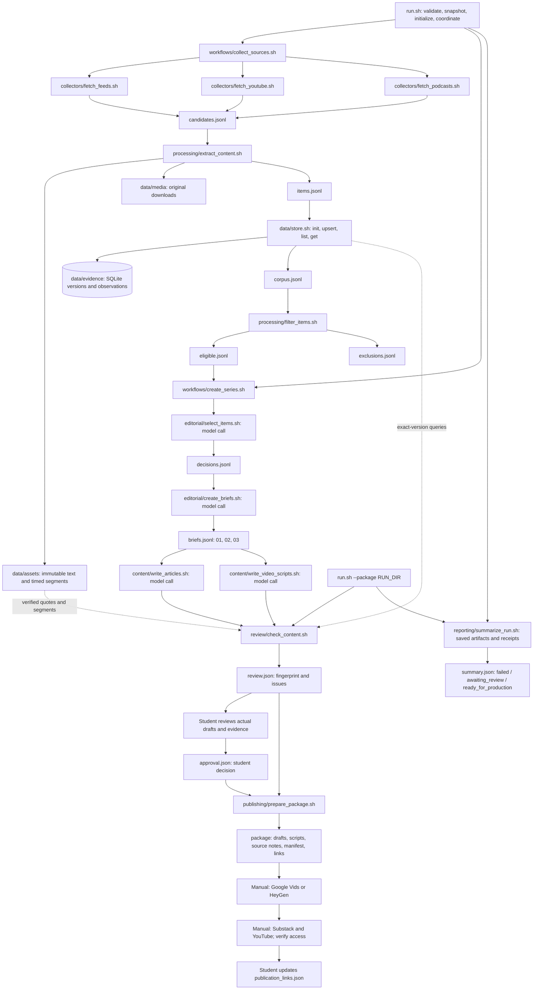

# Problem Set 4 Student Submission

Course instructions: [README.md](README.md). Required contracts: [ARCHITECTURE.md](ARCHITECTURE.md).

**Student:** Sia

**GitHub repository:https://github.com/Sia-Xie-July/Pset4-1.125

## Quick links

| What | Where |
| --- | --- |
| Technical demonstration video (4:48) | **[demo/Before_the_Merge_technical_demo.mp4](demo/Before_the_Merge_technical_demo.mp4)** · narration and shot list: [DEMO_SCRIPT.md](DEMO_SCRIPT.md) |
| Published series (3 Substack articles + 3 YouTube videos) | [Published Series](#published-series) |
| Run command | `bash run_local.sh` (local model) · `bash run_local.sh --package RUN_DIR` |
| Live run 1 (approved, packaged, published) | [runs/20261015T052758Z-daba50c83a0b](runs/20261015T052758Z-daba50c83a0b/) |
| Live run 2 (next day) and comparison | [runs/20261016T000750Z-75c221157a38](runs/20261016T000750Z-75c221157a38/) · [docs/RUN_COMPARISON.md](docs/RUN_COMPARISON.md) |
| Human review sample and policy revision | [EDITORIAL_REVIEW.md](EDITORIAL_REVIEW.md) · [config/editorial_policy.md](config/editorial_policy.md) (v2) · [docs/policy/](docs/policy/) |
| Evidence store | `data/store.sh` → `data/evidence/` (SQLite) · retained text and transcripts in `data/assets/` |

**Status (2026-10-16):** Live run 1 (`runs/20261015T052758Z-daba50c83a0b`) is **approved and packaged** (`ready_for_production`):
28 eligible items, three briefs, three articles, three video scripts, passing content checks,
human review of six editorial decisions, policy v1 → v2 with a selection-stage rerun, and a
matching human `approval.json`. The three Substack articles are public (free) and the three
videos are on YouTube (unlisted); each article and video link to each other.
Live run 2 (`runs/20261016T000750Z-75c221157a38`, as of 2026-10-16) completed with three new items;
the comparison is in [docs/RUN_COMPARISON.md](docs/RUN_COMPARISON.md). The technical demonstration
video is in [demo/](demo/). All deliverables are complete.

## Topic and Audience

- **Publication name:** Before the Merge.
- **Topic:** Evidence-based adoption of AI coding agents by small software teams: delivery speed,
  verification effort, quality, permissions and cost.
- **Audience and assumed knowledge:** Technical leads of 3–10-person software teams shipping web
  applications and internal tools. They know Git, pull requests, automated tests and CI, but have
  no dedicated AI evaluation team.
- **Central question:** Which developments in the preceding 30 days justify changing a small
  team's delivery workflow, and what evidence should come before greater agent autonomy?
- **Scope and exclusions:** Task/context design, testing, review, observable delivery outcomes,
  scoped permissions, rollback and task-level cost. Excludes generic AI investment or employment
  forecasts, unrelated consumer news, unsupported rankings and productivity claims based only on
  generated code or commit volume.
- **Why readers return:** Each edition tests recent claims against their actual support,
  revisits earlier judgments as evidence changes, and gives a reversible evaluation a small team
  can adapt.
- **Voice:** Specific and restrained; source claims, interpretation and uncertainty are labelled.
  Full brief: [PROJECT_BRIEF.md](PROJECT_BRIEF.md). All documentation is in English.

## Published Series

| Piece | Editorial question | Substack article | YouTube video |
| --- | --- | --- | --- |
| 1 | More Agent Output, Better Delivery? What Changed This Month | [Substack article 01](https://user986935.substack.com/p/more-agent-output-better-delivery) | [Before the Merge 01](https://youtu.be/2mOpLgQUm2Y) (unlisted, 3:28) |
| 2 | The Review Bottleneck: Which Productivity Claims Survive Scrutiny? | [Substack article 02](https://user986935.substack.com/p/the-review-bottleneck-which-productivity) | [Before the Merge 02](https://youtu.be/nKaQr6ya9cY) (unlisted, 3:58) |
| 3 | Before You Expand Autonomy: A Small-Team Evaluation Plan | [Substack article 03](https://user986935.substack.com/p/before-you-expand-autonomy-a-small) | [Before the Merge 03](https://youtu.be/cexb5hJ__Ss) (unlisted, 4:29) |

**Technical demonstration video:** [demo/Before_the_Merge_technical_demo.mp4](demo/Before_the_Merge_technical_demo.mp4)
(4:48, captions burned in, subtitles in [demo/Before_the_Merge_technical_demo.en.srt](demo/Before_the_Merge_technical_demo.en.srt)).
It shows the configuration, the architecture and entry point, run 1, one claim traced from article to
transcript segment, run 2 (new / unchanged / duplicates / 30-day window), a recorded collection
failure and its recovery, the human correction and policy revision, and the main tradeoff.
Narration and timings: [DEMO_SCRIPT.md](DEMO_SCRIPT.md); frames are rendered from real run outputs by
[demo/source/](demo/source/) with a synthesized narration voice.

Article sources: `runs/20261015T052758Z-daba50c83a0b/package/articles/01–03.md` (approved drafts). Links are recorded in
`runs/20261015T052758Z-daba50c83a0b/package/publication_links.json`. Each video description lists its sources with dates
and timestamped links, the AI disclosure and the other episodes; YouTube's AI-content label is
on and corrected English subtitles are attached. Video production, QA results and upload steps:
[VIDEO_PRODUCTION.md](VIDEO_PRODUCTION.md). Access was checked without signing in (YouTube oEmbed; Substack public post API returns the full body, audience `everyone`).

## Setup and Execution

Requirements: macOS with Bash 3.2-compatible scripts, `python3`, `jq`, `ffmpeg`/`ffprobe`,
`yt-dlp`, and a Python virtual environment with `requirements.txt`. Install with
`brew install ffmpeg yt-dlp jq`, then follow [SETUP.md](SETUP.md).

**Model (live run 1):** local Ollama `qwen3:8b` via `run_local.sh` (no API key; API cost $0,
hardware and electricity excluded). Start Ollama with `OLLAMA_NO_CLOUD=1 ollama serve`.
Earlier failed attempts used an OpenAI-compatible endpoint (`gpt-5.4-mini`); the launcher reads
`MODEL_PROVIDER`, `MODEL_BASE_URL`, `MODEL_NAME` and `MODEL_API_KEY`/`OPENAI_API_KEY` from the
environment only — no credential is stored in the repository.

**Transcripts:** native YouTube/podcast captions first, then local faster-whisper (`base`, `cpu`,
`int8`; overridable with `WHISPER_MODEL`, `WHISPER_DEVICE`, `WHISPER_COMPUTE_TYPE`).
`MAX_DURATION_MINUTES` (70 in `run_local.sh`) caps media length deliberately.

**Configuration:** topic in [config/project.json](config/project.json), sources in
[config/sources.json](config/sources.json) (independence notes: [SOURCE_NOTES.md](SOURCE_NOTES.md)),
policy in [config/editorial_policy.md](config/editorial_policy.md) (v2), prompts in [prompts/](prompts/).

**Commands**

```bash
bash run_local.sh                       # full run: collect → series → checks; stops at awaiting_review
bash run_local.sh --resume-series RUN   # retry from briefs with the same run date and decisions
bash review/check_content.sh RUN > RUN/review.json   # recompute review_id after edits
# write RUN/approval.json (review_id, decision, reviewer, reviewed_at, notes)
bash run_local.sh --package RUN         # re-check, package on matching approval, refresh summary
```

Every component also runs on its own (`bash editorial/select_items.sh RUN < RUN/eligible.jsonl`,
`bash data/store.sh list`, …); see [SETUP.md](SETUP.md) and [NEXT_STEPS.md](NEXT_STEPS.md).
Offline tests: `python3 -m pytest -q tests/`.

## Architecture and Manual Handoffs



`run.sh` and the two workflows only coordinate; each of the 16 required scripts owns one
responsibility and delegates to focused Python helpers in its own directory. Models are called
only in `editorial/select_items.sh`, `editorial/create_briefs.sh`, `content/write_articles.sh` and
`content/write_video_scripts.sh`. Only `data/store.sh` opens the SQLite index (`data/evidence/`);
retained text and timed transcripts are in `data/assets/`, original media in `data/media/`
(excluded from Git). Every invocation writes a receipt to `RUN/logs/`.

**Small-context design.** For the local 8B model, selection sends at most four labelled,
keyword-ranked excerpts per item; briefs and drafts receive only the passages they cite. Passage
IDs are mapped back in code to exact item/version/segment references.

**Manual handoffs (all done for run 1):**

| Step | Input | Output |
| --- | --- | --- |
| Human editorial review | `review.json`, briefs, drafts, retained passages | [EDITORIAL_REVIEW.md](EDITORIAL_REVIEW.md), corrections in `runs/20261015T052758Z-daba50c83a0b/human_edits/` |
| Approval | current `review_id` | `runs/20261015T052758Z-daba50c83a0b/approval.json` (decision `approve`, reviewer Sia, 2026-10-15T19:36:52Z) |
| Package | `run_local.sh --package` | `runs/20261015T052758Z-daba50c83a0b/package/` (articles, scripts, source notes, `manifest.json`, `MANUAL_STEPS.md`, `publication_links.json`) |
| Video production | `runs/20261015T052758Z-daba50c83a0b/production/01–03.txt`, `VIDEO_PLAN.md` | Google Vids videos with AI avatar intro, 10–11 image scenes, captions; QA by `publishing/check_video.py` (all PASS) |
| YouTube | MP4s, `youtube_description_NN_upload.txt`, `subtitles/captions_NN_timed.srt` | three unlisted videos (links above) |
| Substack | `production/substack/NN.html` (built from `package/articles/NN.md` by `production/substack/build.py`) | three free public posts (links above); each links its video, and each video description links its article |

## Evidence and Runs

| Run | Date (UTC) | What it shows | Elapsed | Cost |
| --- | --- | --- | --- | --- |
| [20261015T033409Z-1f5a3ca7b12c](runs/20261015T033409Z-1f5a3ca7b12c/), [20261015T033422Z-009fe9b412ba](runs/20261015T033422Z-009fe9b412ba/) | 2026-10-15 | Sandbox-restricted and bounded smoke collections; collector failures recorded | 3 s / 9 s | null |
| [20261015T033503Z-f6539b3bc938](runs/20261015T033503Z-f6539b3bc938/) | 2026-10-15 | First live collection: feed collector failed on RSS CDATA; parser repaired; retry in `diagnostics/feeds-after-xml-fix.jsonl`; labelled replay in `diagnostics/replay-*.json*` (new 0, changed 0, unchanged 22) | 473 s | null |
| [20261015T035002Z-e05bbed2241b](runs/20261015T035002Z-e05bbed2241b/), [20261015T040201Z-6f8029259331](runs/20261015T040201Z-6f8029259331/) | 2026-10-15 | Recovery collection (25 eligible) and API model attempts; briefs rejected by validation (missing input types, wrong versions/segments) | 494 s / 1621 s | $0.51 / $0.91 (gpt-5.4-mini) |
| [20261015T044923Z-8de27f7e5e00](runs/20261015T044923Z-8de27f7e5e00/) | 2026-10-15 | Source discovery check only; podcast 403 and header fix | — | null |
| [20261015T045414Z-01ea8124a37c](runs/20261015T045414Z-01ea8124a37c/), [20261015T051103Z-7d7fdf0780a3](runs/20261015T051103Z-7d7fdf0780a3/), [20261015T052646Z-0f4d5174c80c](runs/20261015T052646Z-0f4d5174c80c/) | 2026-10-15 | Failed attempts kept as failure records (extraction/selection/brief stages) | 105 s / 141 s / 27 s | null / $0.23 / null |
| **[20261015T052758Z-daba50c83a0b](runs/20261015T052758Z-daba50c83a0b/)** — live run 1 | 2026-10-15 | Complete run: 28 eligible (18 written, 5 podcast, 5 YouTube; 10 publisher groups); same-input re-collection gave new 0 / changed 0 / unchanged 23 (`changes.jsonl`), duplicate observations 0; 25 accept / 2 reject / 1 defer; approved and packaged | generation 05:27–05:50; packaged 19:37 | $0 (local) |
| **[20261016T000750Z-75c221157a38](runs/20261016T000750Z-75c221157a38/)** — live run 2 | 2026-10-16 | Same store, policy v2: new 3 (two GitHub changelog posts, one Cloudflare post, all published 2026-10-15), changed 0, unchanged 20, duplicates 0, exclusions 0; 31 eligible (21 written, 5 podcast, 5 YouTube); 25 accept / 0 reject / 6 defer; checks passed; `awaiting_review`, not published (see [docs/RUN_COMPARISON.md](docs/RUN_COMPARISON.md)) | 912 s | $0 (local) |

**What changed between the runs:** three items published on 15 October were detected as new; 20
unchanged items were not reprocessed; no item crossed the 30-day boundary. With policy v2 the
selection deferred more and rejected less, the new items were accepted but not cited, and the briefs
were rebuilt around different sources; run 2 also repeated a vendor claim that the run 1 review had
corrected, so it was not approved or published. Full comparison: [docs/RUN_COMPARISON.md](docs/RUN_COMPARISON.md).

Known cost: about $1.65 of API usage across the three failed gpt-5.4-mini attempts; unknown
costs stay `null` in the summaries. `summary.json` in each run reports coverage, changes,
failures, models and remaining manual work.

**Freshness and exclusions:** `processing/filter_items.sh` applies the inclusive 30-day window to
original publication dates (`eligible.jsonl`, `exclusions.jsonl`; window 2026-09-16 – 2026-10-15
for run 1). Undated items are excluded.

**Trace of one published claim (piece 01, claim 01-c1):**
1. Article `runs/20261015T052758Z-daba50c83a0b/articles/01.md`: Jake Cukjati says “the agents go through and test everything,
   implement it” [01-c1].
2. Brief `runs/20261015T052758Z-daba50c83a0b/briefs.jsonl`, piece 01, claim `01-c1` (type `source_claim`): agents take a
   specification into implementation planning, then test and implement the work.
3. Decision `runs/20261015T052758Z-daba50c83a0b/decisions.jsonl`: `youtube:-65TrkDP1jY` accepted for pieces 01 and 02.
4. Source version `cfb489cd2c42f6303a5ca94235eafe31778abae9637f655527a7c04a346b57ad`
   (published 2026-10-09, retrieved 2026-10-15), segments `s-000089`–`s-000096`, about
   5:41–6:15, in `data/assets/533e271168a2e488fc618ccb020749216cf81e7128e481c504d3d1e1dbdec261.segments.json`.
5. Video 01 cites the same passage at 5:41–6:15 in its description.

## Editorial Review

- Policy: [config/editorial_policy.md](config/editorial_policy.md) (v2); v1 at
  [docs/policy/editorial_policy_v1.md](docs/policy/editorial_policy_v1.md); diff
  [docs/policy/v1_to_v2.diff](docs/policy/v1_to_v2.diff). Prompts: [prompts/](prompts/); each
  run snapshots policy and prompts under `RUN/config/` and `RUN/prompts/`.
- **Review of 3 accepted + 3 rejected/deferred items:** [EDITORIAL_REVIEW.md](EDITORIAL_REVIEW.md).
  I disagreed with four of six AI decisions: A1 (Python 3.15 release accepted although off-scope),
  R1 (podcast rejected because excerpt retrieval missed the relevant 19:37–21:56 section),
  R2 (right outcome, false reason "incoherent"), D1 (deferral without naming missing information).
- **Policy revision:** v2 requires relevance to be shown by a named passage, treats vendor
  capability adjectives as unverified claims, excludes sponsor reads as evidence, defaults
  excerpt-limited judgments to defer, requires per-piece justification and keeps automatic
  captions of non-English speech paraphrase-only.
- **Rerun of the affected stage:** `runs/20261015T052758Z-daba50c83a0b/policy_v2_rerun/` (same 28 items, model and prompts;
  only the policy differs). v1: 25 accept / 2 reject / 1 defer → v2: 23 / 1 / 4. On the reviewed
  items the effect was mixed: R1 became accept (but its reason cited a sponsor read that v2 forbids),
  R2 became accept (I would reject), A1 stayed accept and D1 stayed defer. Conclusion: the policy
  text alone cannot fix judgments when the retrieved excerpts miss the relevant passage; the
  retrieval step is the bottleneck. Details: `policy_v2_rerun/comparison.md`.
- **Factual corrections before approval** (`runs/20261015T052758Z-daba50c83a0b/human_edits/CORRECTIONS.md`, originals in
  `human_edits/original/`): removed brief 01's unsupported "measurable improvement"; narrowed
  claims 01-c1 and 01-c3; relabelled brief 02-c2 as a Blitzy sponsor advertisement; re-mapped
  brief 03 evidence that had been attached to the wrong quotes; lengthened article 02 (568 → ~754
  words) without new claims; aligned scripts with the produced narration and AI disclosure.
- **Remaining limitations:** excerpt-based selection; translated automatic captions for the
  Italian sources (paraphrase only); vendor and practitioner claims are not controlled
  measurements; the burned-in captions in the videos contain a few speech-recognition misspellings
  (the attached YouTube subtitles are corrected).
- **Approval evidence:** `runs/20261015T052758Z-daba50c83a0b/review.json` (`passed: true`, `review_id`
  `93d84d1a…89fc`) matches `runs/20261015T052758Z-daba50c83a0b/approval.json`; packaging succeeded (`summary.json` status
  `ready_for_production`).

## Reflection

**Insight.** Across the sources, the strongest recent material describes *how* teams structure
agent work (specifications, staged plans, step-by-step narration, test harnesses), while none of it
measures delivery outcomes. The series therefore argues that the decision-relevant question is
where verification work moves, and turns that into a reversible small-team evaluation plan.

**Editorial failure.** The model's decisions were often driven by which excerpts it saw rather
than by the policy: it accepted an off-topic Python release, rejected a podcast whose relevant
section was never retrieved, and in briefs attached quotes to the wrong claims and presented a
sponsor read as a finding. Mechanical checks passed; only human review against the passages
caught these, and the policy revision alone did not fix them.

**Next improvement.** Retrieve passages per editorial question (and per claim) instead of by
keyword overlap with the topic sentence, and have the checker verify that each claim's quote
actually entails its statement.

**Architectural tradeoff.** Immutable, content-addressed evidence with exact version and segment
locators, behind a store-only index, costs extra storage and validation, but it lets every
published claim be traced to the exact passage that supported it and makes re-collection
idempotent (run 1 re-collected 23 unchanged items without duplicates). Conservative identity
reconciliation (exact bytes or reciprocal links, not title similarity) avoids false merges at the
price of leaving some copies for human review.
